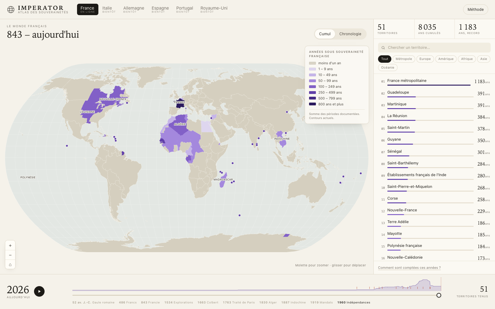
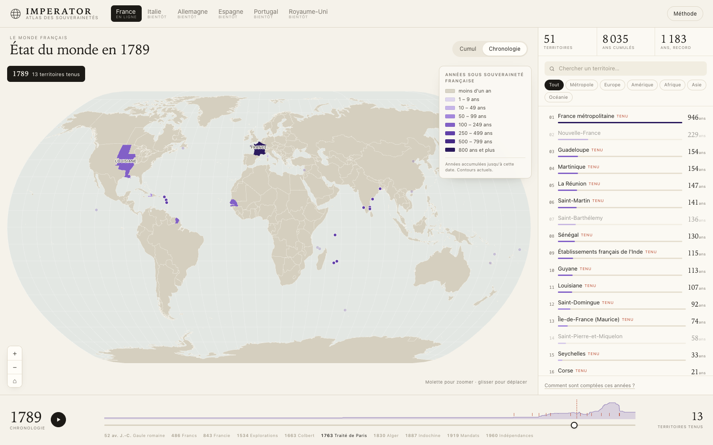
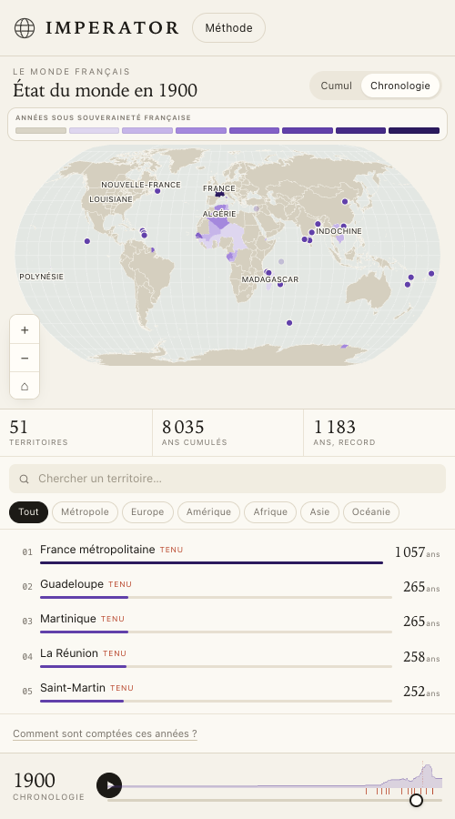

[🇫🇷 FR](README.md) · [🇬🇧 EN](README_en.md)

# Imperator — Le monde français

**Un planisphère interactif : combien d'années chaque territoire du monde a-t-il passé sous
souveraineté française ?** De la Gaule romaine à aujourd'hui, 51 territoires, un curseur
temporel et des fiches sourcées.



## Ce que fait le site

- **Carte choroplèthe** — chaque territoire est coloré selon le nombre d'années de souveraineté
  française, périodes additionnées (7 classes, de « moins d'un an » à « 800 ans et plus »).
- **Chronologie jouable** — un curseur va de 120 av. J.-C. à 2026 ; le bouton lecture rejoue
  l'histoire en une quinzaine de secondes. À chaque date, la carte et la liste montrent ce qui
  était tenu, et depuis combien d'années.
- **51 fiches** — périodes détaillées, nombres d'années par période, note critique, lien source.
- **Recherche et filtres** par région, liste classée, barres comparatives.
- **Carte navigable** — zoom molette, déplacement, recentrage automatique sur un territoire.
- **Liens partageables** — `?an=1789` ouvre une date, `?t=algerie` une fiche, `#methode` la note
  de méthode.
- Responsive, sans dépendance réseau, sans build.





## Lancer en local

Les données et le code sont chargés en modules ES : il faut un serveur HTTP (ouvrir `index.html`
directement ne fonctionne pas).

```sh
cd Web_imperator
python3 -m http.server 8080
# → http://localhost:8080
```

## Déployer

Aucune étape de build : le dossier est le site. Il se dépose tel quel sur Netlify, Vercel,
GitHub Pages, un o2switch ou n'importe quel hébergement statique.

## Comment les années sont comptées

Un territoire compte dès qu'une autorité française y exerce la souveraineté : prise de
possession, traité, annexion, protectorat ou mandat. Il cesse de compter à la cession, à
l'indépendance ou à la perte militaire. **Les périodes sont additionnées** : Saint-Pierre-et-Miquelon,
perdu et rendu trois fois, cumule ses trois occupations.

Deux points assumés :

1. **Métropole : 1 183 ans, pas 843.** La carte virale qui a inspiré ce projet affiche « 843 ans » :
   c'est l'année du traité de Verdun confondue avec une durée. De 843 à 2026 il y a 1 183 ans.
   Les occupations (Alsace-Moselle 1871-1918 et 1940-1944) ne sont pas déduites.
2. **Contours actuels.** Faute de pouvoir dessiner chaque frontière historique, la Nouvelle-France
   est figurée par les provinces et États actuels qu'elle recouvrait en partie. La carte mesure une
   *présence*, pas une ligne de front.

Détail complet dans la fenêtre « Méthode » du site.

## Structure

```
index.html
assets/
  css/app.css            feuille unique, variables de couleur
  js/app.js              moteur : projection, carte, chronologie, panneau
  js/data/france.js      ★ les données historiques (le seul fichier à éditer)
  data/world.geo.json    contours Natural Earth 50m simplifiés (583 Ko)
  vendor/                d3-selection, d3-array, d3-geo (copies locales)
  img/favicon.svg
tools/build-geo.py       régénère world.geo.json depuis world-atlas / us-atlas / Canada
screenshots/
```

## Ajouter un pays

Le moteur est générique. Ajouter l'Italie, l'Allemagne ou le Portugal revient à écrire un fichier
de données du même format que `assets/js/data/france.js`, puis à le brancher dans le sélecteur.
La procédure est décrite dans [docs/ajouter-un-pays.md](docs/ajouter-un-pays.md).

## Sources

- Contours : [Natural Earth](https://www.naturalearthdata.com/) via `world-atlas` 1:50m,
  `us-atlas` (États américains) et un découpage des provinces canadiennes.
- Dates et récits : pages Wikipédia, liées depuis chaque fiche.

Les dates sont les plus couramment admises ; elles restent discutables, et les cas litigieux sont
signalés dans les notes.

## Soutenir

Ce projet est libre et sans publicité. Un café aide à financer les prochains atlas :

[☕ ko-fi.com/pouark](https://ko-fi.com/pouark)
