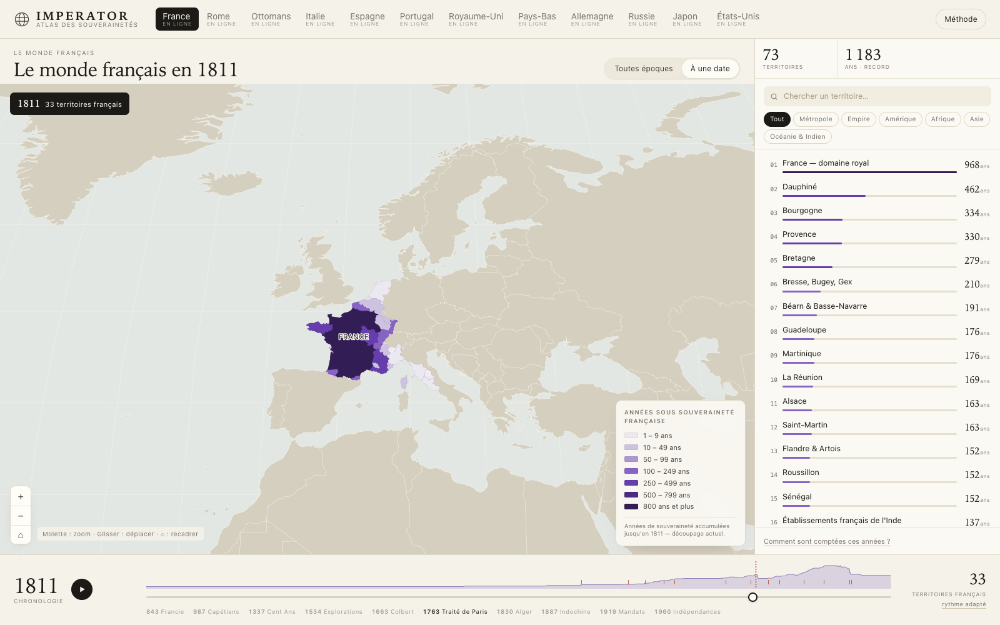
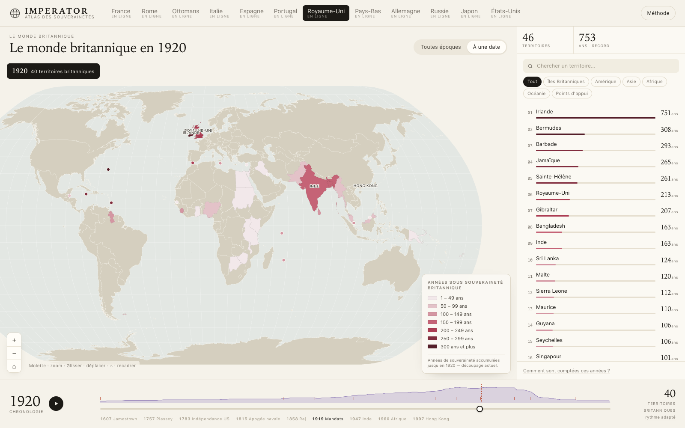
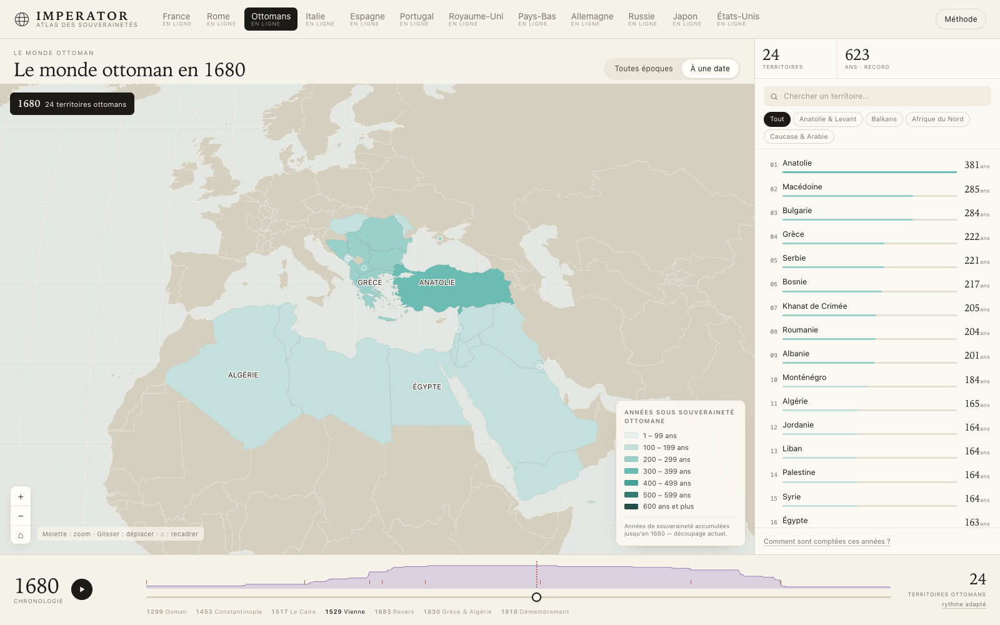
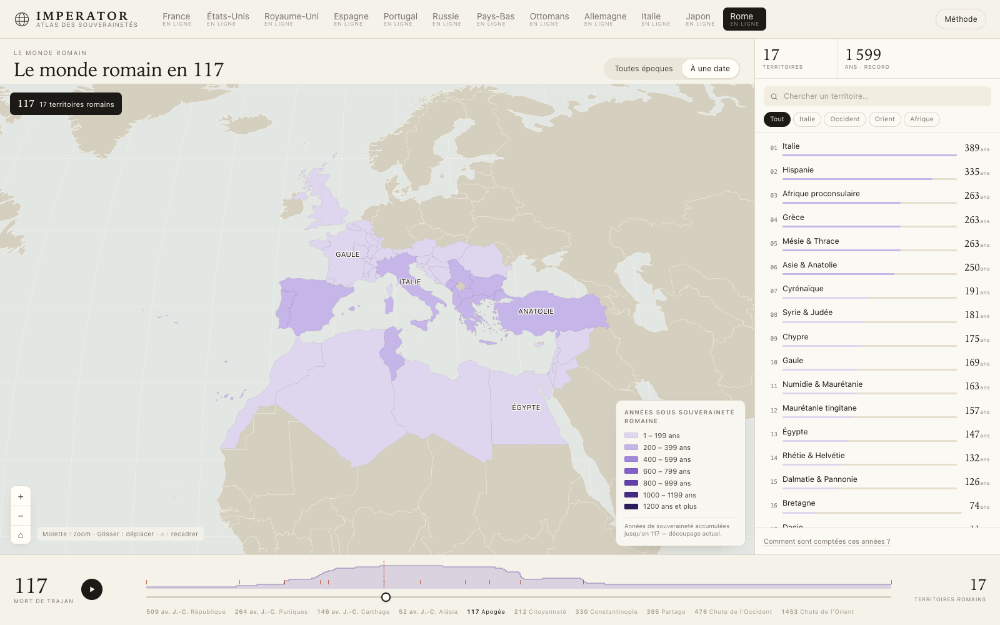
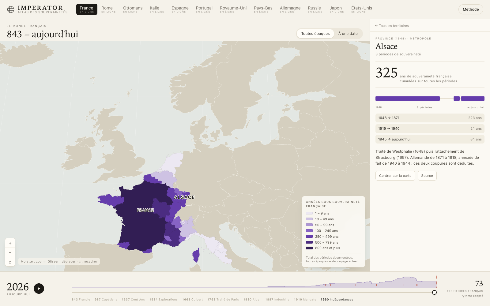

[🇫🇷 FR](README.md) · [🇬🇧 EN](README_en.md)

# Imperator — Le monde français

**Version 2026.11.15**

**Un planisphère interactif : combien d'années chaque territoire du monde a-t-il passé sous
souveraineté française ?** **Douze atlas en ligne** : France, États-Unis, Royaume-Uni, Espagne, Portugal, Russie, Pays-Bas,
Empire ottoman, Allemagne, Italie, Japon, Rome — 295 territoires au total, un curseur temporel et
des fiches sourcées.


## Ce que fait le site

- **Carte choroplèthe** — chaque territoire est coloré selon le nombre d'années de souveraineté
  française, périodes additionnées (7 classes, de « 1 à 9 ans » à « 800 ans et plus »).
- **La France par provinces** — la métropole est découpée en provinces historiques reconstituées à
  partir des départements (Dauphiné, Bourgogne, Provence, Bretagne, Savoie, Nice, Comtat, Alsace…),
  et l'Empire napoléonien par régions (Piémont, Toscane, Latium, Belgique, Pays-Bas).
- **Chronologie jouable** — un curseur va de 843 à 2026 ; le bouton lecture rejoue l'histoire en
  une vingtaine de secondes. À chaque date, la carte et la liste montrent ce qui était français, et
  depuis combien d'années.
- **Cadrage automatique** — la carte se resserre sur la France au IXe siècle et s'élargit au
  planisphère à mesure que l'empire colonial s'étend ; le zoom manuel reprend la main.
- **Fiches par territoire** — périodes détaillées, nombres d'années par période, note critique, lien source.
- **Onze pays, un moteur** — `?pays=royaume-uni`, `?pays=ottoman`, `?pays=russie`… Chaque atlas a
  ses territoires, ses classes de couleur, sa méthode et son vocabulaire. Le sélecteur du bandeau
  bascule d'un empire à l'autre sans rechargement de code.
- **Recherche et filtres** par région, liste classée, barres comparatives.
- **Carte navigable** — zoom molette, déplacement, recentrage automatique sur un territoire.
- **Liens partageables** — `?an=1789` ouvre une date, `?t=algerie` une fiche, `#methode` la note
  de méthode.
- Responsive, sans dépendance réseau, sans build.










## Lancer en local

Les données et le code sont chargés en modules ES : il faut un serveur HTTP (ouvrir `index.html`
directement ne fonctionne pas).

```sh
cd Web_imperator
python3 -m http.server 8080
# → http://localhost:8080
```

## Déployer

Aucune étape de build : le dossier est le site. Il se dépose tel quel sur Netlify, Vercel,
GitHub Pages, un o2switch ou n'importe quel hébergement statique.

## Comment les années sont comptées

Un territoire compte dès qu'une autorité française y exerce la souveraineté : prise de
possession, traité, annexion, protectorat ou mandat. Il cesse de compter à la cession, à
l'indépendance ou à la perte militaire. **Les périodes sont additionnées** : Saint-Pierre-et-Miquelon,
perdu et rendu trois fois, cumule ses trois occupations.

Deux points assumés :

1. **Domaine royal : 1 183 ans, pas 843.** La carte virale qui a inspiré ce projet affiche « 843 ans » :
   c'est l'année du traité de Verdun confondue avec une durée. De 843 à 2026 il y a 1 183 ans.
   Les occupations de la métropole ne sont pas déduites ; pour l'Alsace et la Moselle, si :
   les deux annexions allemandes (1871-1918 et 1940-1944) sont retirées.
2. **Contours actuels.** Les provinces françaises sont reconstituées par groupes de départements
   actuels ; la Nouvelle-France est figurée par les provinces et États actuels qu'elle recouvrait en
   partie. La carte mesure une *présence*, pas une ligne de front.
3. **Départ en 843.** La Gaule romaine et le royaume franc sont des antécédents, pas la France :
   ils ne sont ni affichés ni comptés.

Détail complet dans la fenêtre « Méthode » du site.

## Structure

```
index.html
assets/
  css/app.css            feuille unique, variables de couleur
  js/app.js              moteur : projection, carte, chronologie, panneau
  js/data/france.js      ★ données France
  js/data/usa.js         ★ données États-Unis
  js/data/royaume-uni.js, espagne.js, portugal.js, russie.js,
  pays-bas.js, ottoman.js, allemagne.js, italie.js, japon.js
  js/data/index.js       registre des pays
  data/world.geo.json    contours Natural Earth 50m (683 Ko) + provinces françaises
  vendor/                d3-selection, d3-array, d3-geo (copies locales)
  img/favicon.svg
tools/build-geo.py       régénère world.geo.json (Natural Earth, départements, régions italiennes)
screenshots/
```

## Ajouter un pays

Le moteur est générique : la France et les États-Unis ne partagent aucun code spécifique, seulement
un format de données. Ajouter le Royaume-Uni, l'Espagne ou le Portugal revient à écrire un fichier
du même format, puis à l'inscrire dans le registre. La procédure est décrite dans
[docs/ajouter-un-pays.md](docs/ajouter-un-pays.md).

## Sources

- Contours : [Natural Earth](https://www.naturalearthdata.com/) via `world-atlas` 1:50m,
  `us-atlas` (États américains) et un découpage des provinces canadiennes.
- Dates et récits : pages Wikipédia, liées depuis chaque fiche.

Les dates sont les plus couramment admises ; elles restent discutables, et les cas litigieux sont
signalés dans les notes.

## Soutenir

Ce projet est libre et sans publicité. Un café aide à financer les prochains atlas :

[☕ ko-fi.com/pouark](https://ko-fi.com/pouark)
