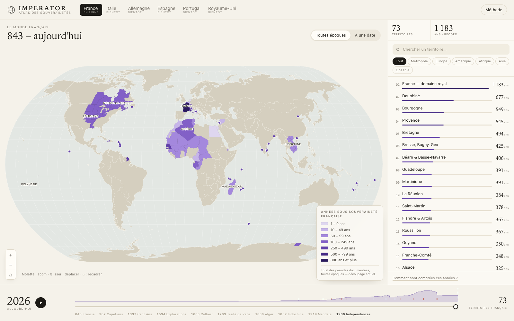
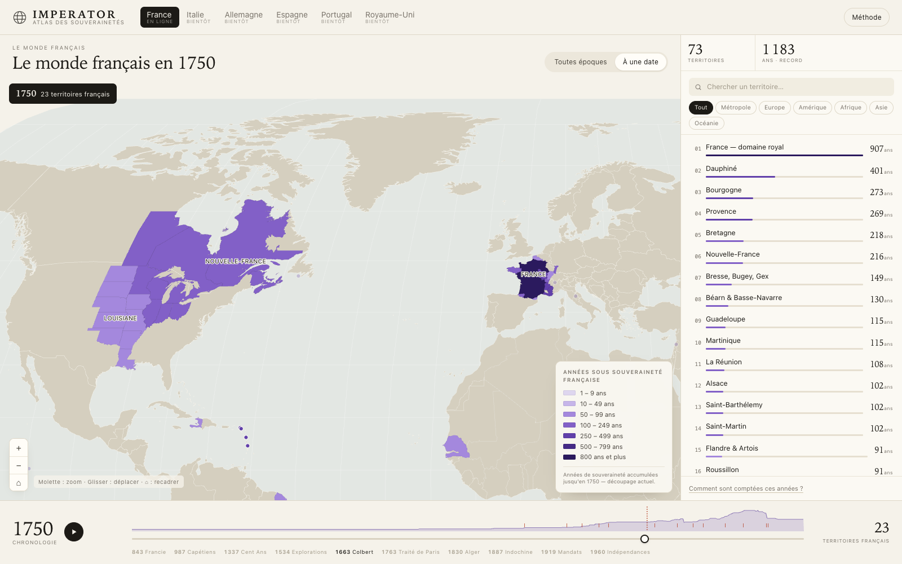
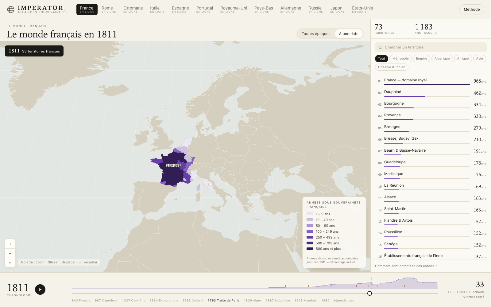
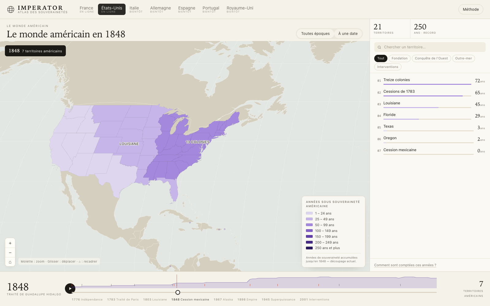
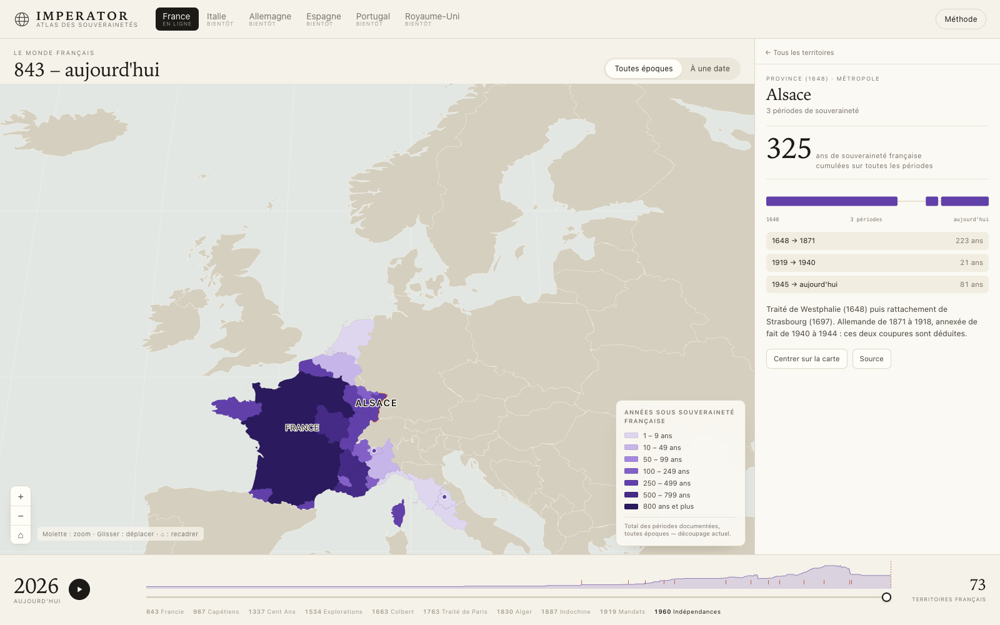
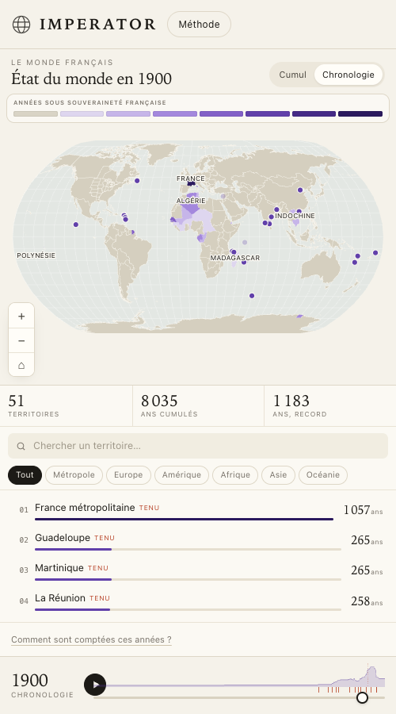

[🇫🇷 FR](README.md) · [🇬🇧 EN](README_en.md)

# Imperator — The French World

**An interactive planisphere: how many years did each territory in the world spend under French
sovereignty?** Two atlases online: **France** (73 territories, from 843) and the **United States** (21 territories,
from 1776), with a time cursor and sourced profiles.



## What it does

- **Choropleth map** — every territory is shaded by its number of years under French sovereignty,
  all periods added up (7 classes, from "1 to 9 years" to "800 years and more").
- **France by province** — mainland France is split into historical provinces rebuilt from today's
  departments (Dauphiné, Burgundy, Provence, Brittany, Savoy, Nice, Comtat, Alsace…), and the
  Napoleonic Empire by region (Piedmont, Tuscany, Latium, Belgium, Netherlands).
- **Playable timeline** — a cursor runs from 843 to 2026; the play button replays the whole story
  in about twenty seconds. At any date, the map and the list show what was French, and for how long.
- **Automatic framing** — the map closes in on France in the 9th century and widens to the whole
  planisphere as the colonial empire grows; manual zoom takes over at any time.
- **Profiles per territory** — detailed periods, years per period, a critical note, a source link.
- **Two countries, one engine** — `?pays=usa` switches to the United States: the acquisitions
  (Louisiana, Mexican Cession, Alaska, Hawaii…), the overseas empire and the interventions. Each
  country has its own colour classes, method text and wording.
- **Search and filters** by region, ranked list, comparison bars.
- **Navigable map** — wheel zoom, drag, automatic recentring on a territory.
- **Shareable links** — `?an=1789` opens a date, `?t=algerie` a profile, `#methode` the method
  note.
- Responsive, no network dependency, no build step.







## Run locally

Data and code are loaded as ES modules, so a small HTTP server is required (opening `index.html`
directly will not work).

```sh
cd Web_imperator
python3 -m http.server 8080
# → http://localhost:8080
```

## Deploy

No build: the folder *is* the site. Drop it as-is on Netlify, Vercel, GitHub Pages, o2switch or any
static host.

## How years are counted

A territory counts as soon as a French authority exercises sovereignty there: possession, treaty,
annexation, protectorate or mandate. It stops counting at cession, independence or military loss.
**Periods are added together**: Saint-Pierre-et-Miquelon, lost and returned three times, stacks all
three occupations.

Two deliberate choices:

1. **Royal domain: 1,183 years, not 843.** The viral map that inspired this project shows
   "843 years" — that is the year of the Treaty of Verdun mistaken for a duration. From 843 to 2026
   there are 1,183 years. Occupations of the mainland are not deducted; for Alsace and Moselle they
   are (both German annexations, 1871-1918 and 1940-1944).
2. **Present-day borders.** French provinces are rebuilt from groups of present-day departments;
   New France is shown with the modern provinces and states it partly covered. The map measures a
   *presence*, not a front line.
3. **Starting in 843.** Roman Gaul and the Frankish kingdom are antecedents, not France: neither
   shown nor counted.

The full rationale lives in the site's "Méthode" dialog.

## Structure

```
index.html
assets/
  css/app.css            single stylesheet, colour tokens
  js/app.js              engine: projection, map, timeline, panel
  js/data/france.js      ★ France dataset
  js/data/usa.js         ★ United States dataset
  js/data/index.js       country registry
  data/world.geo.json    Natural Earth 50m outlines (683 KB) + French provinces
  vendor/                d3-selection, d3-array, d3-geo (local copies)
  img/favicon.svg
tools/build-geo.py       rebuilds world.geo.json from world-atlas / us-atlas / Canada
screenshots/
```

## Adding a country

The engine is generic: France and the United States share no country-specific code, only a data
format. Adding the United Kingdom, Spain or Portugal means writing a dataset file in the same shape
and registering it. The procedure is
documented (in French) in [docs/ajouter-un-pays.md](docs/ajouter-un-pays.md).

## Sources

- Outlines: [Natural Earth](https://www.naturalearthdata.com/) via `world-atlas` 1:50m,
  `us-atlas` (US states) and a Canadian provinces split.
- Dates and narratives: Wikipedia pages, linked from every profile.

Dates follow the most commonly accepted accounts; they remain debatable, and contested cases are
flagged in the notes.

## Support

This project is free and ad-free. A coffee funds the next atlases:

[☕ ko-fi.com/pouark](https://ko-fi.com/pouark)
